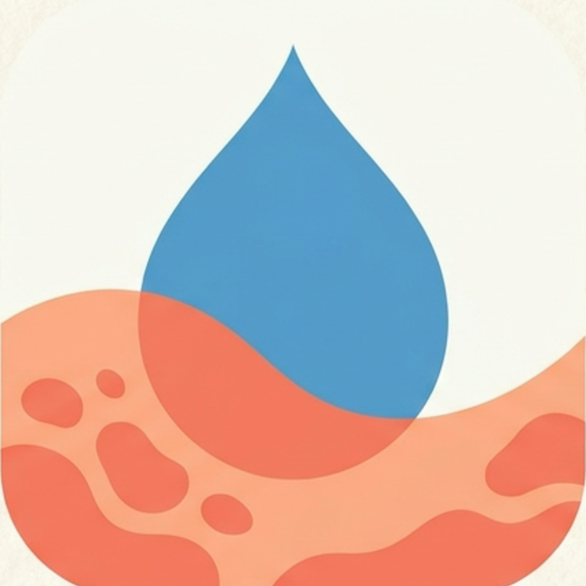

# FlareDown



A psoriasis tracker. Log a short check-in each day and it gives you a flare risk score from 0 to 100 for the next 3 days. Experimental, not medical advice.

## Install

You need Node.js and Android Studio. Connect an Android phone with USB debugging on, or start an emulator.

```
cd app
npm install
```

## Run

```
cd app
npx expo run:android
```

## Rules

The score adds up the points from these 12 rules. They live in `app/assets/rulebook.json`.

1. Skin getting worse: up to +30 (skin today vs. your usual)
2. Stress: up to +15 (average stress 7-14 days ago)
3. Being sick: up to +10 (sick 7-14 days ago)
4. Short sleep: up to +15 (average sleep, last 7 days)
5. Itch: up to +15 (average itch, last 3 days)
6. Sore throat: up to +5 (10-14 days ago)
7. Skin injury: up to +5 (cut, scrape or sunburn 10-14 days ago)
8. Nightshade vegetables: up to +5 (servings a day, last 5 days)
9. Processed food: up to +15 (days with processed food, last 7 days)
10. Air pollution: up to +5 (PM2.5, last 3 days)
11. Temperature drop: up to +5 (biggest drop, 1-3 days ago)
12. Sunshine: up to -10 (average UV index, last 7 days)
